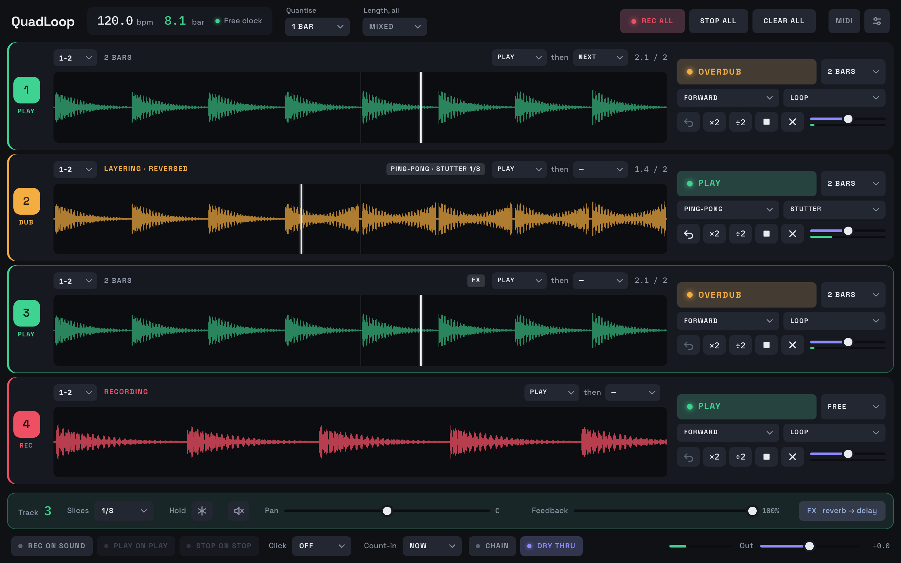

<div align="center">

# QuadLoop

**Four loop slots that launch on the bar, to the sample, in any DAW.**

VST3 · Audio Unit · CLAP · Standalone — macOS (universal) and Windows

### [⬇&nbsp; Download the beta](../../releases) &nbsp;·&nbsp; [wavenstein.com/quadloop](https://wavenstein.com/quadloop/)

</div>



---

A four-track looper, built because Bitwig ships none and the loopers in other hosts
tend to give you one track and a fixed length. One stereo input, four independent
lanes, no routing to set up: it behaves the same in every host, the way a hardware
looper does. As a standalone app it is a complete looper with its own clock, inputs,
effects and click.

## Which download

Each release has two files:

| File | For |
| --- | --- |
| `QuadLoop-…-beta-….pkg` | **macOS.** Signed and notarised by Apple. Installs the VST3, Audio Unit, CLAP and the standalone app; untick what you do not need. |
| `QuadLoop-…-beta-…-windows.zip` | **Windows.** The VST3, the CLAP and `QuadLoop.exe`, the standalone. |

`EULA.txt` and `THIRD-PARTY-NOTICES.txt` are attached to every release too.

| Format | Hosts |
| --- | --- |
| **CLAP** | Bitwig Studio, Reaper. The best of the three in Bitwig. |
| **VST3** | Ableton Live, Studio One, Cubase, Reaper, FL Studio |
| **Audio Unit** | Logic Pro, GarageBand, MainStage, and Ableton Live on macOS |
| **Standalone** | No host at all |

## Installing

**macOS.** Double-click the `.pkg` and follow it. It asks for your password once,
because plug-ins live in a shared folder. Restart your music software afterwards so
it rescans; Logic and GarageBand only look once per launch.

**Windows.** Unzip, then copy

- `QuadLoop.vst3` to `C:\Program Files\Common Files\VST3`
- `QuadLoop.clap` to `C:\Program Files\Common Files\CLAP`

and keep `QuadLoop.exe` wherever you like. The Windows build is not code-signed yet,
so SmartScreen asks first: **More info**, then **Run anyway**. The interface needs
Microsoft's WebView2 runtime, which Windows 10 and 11 already have; if the window
stays blank, install it from Microsoft.

## What it does

| | |
| --- | --- |
| **Launch on the grid** | Loops open and close on the bar or the division you pick, to the sample, so lanes stay locked to each other and to the project. |
| **Record lengths** | Free, fixed bars or beats, or Auto: play as long as you like and it rounds to the nearest whole bar. |
| **Follow actions** | When a take closes, the lane can play, go quiet or keep layering, and the next lane can start recording, so a whole song builds without your hands leaving the instrument. |
| **Direction and playback** | Forward, reverse, ping-pong or scatter; loop, once, shuffle, stutter, drop or freeze. Reverse one bar inside a running loop by clicking it. |
| **Effects** (standalone) | Two slots per lane: chorus, flanger, phaser, doubler, delay, reverb, filter, drive and a trance gate, with delay times and sweeps in note values. |
| **Starting by itself** | Record when the DAW's transport starts, or in the standalone, when you start playing. |
| **Getting loops out** | Export any lane as a WAV with its tempo embedded. Loops are saved inside your project. |

## Timing

A launch fires on the sample it was scheduled for, not on the next buffer boundary.

```
120 bpm, 48 kHz      one bar = 96,000 samples
buffer                          512 samples
                     96000 / 512 = 187.5
```

A bar does not divide evenly into a buffer, which is exactly why this matters. Firing
on block boundaries instead would land launches up to **10.6 ms late at a 512-sample
buffer, and inconsistently late**, which is what makes loops drift audibly against
the grid over the course of a set.

## About the beta

Releases marked **pre-release** are betas. Each one stops **recording** on the date
in its file name and its release notes; playback keeps working past that date, so an
expired beta never goes silent in the middle of a session. A newer build comes before
the old one expires.

Projects made with a beta open in later versions: the plug-in identity and the saved
format do not change between them.

## Reporting something

Email **wavensteinaudio@gmail.com** with:

- **the build** (the file name you downloaded)
- **your host** and its version, and whether you loaded the VST3, AU, CLAP or the standalone
- **your system**, sample rate and buffer size
- what you did, and what happened instead

Timing and sync problems are worth reporting even when they sound minor. Sample
accuracy is what QuadLoop is built around, so "it drifted slightly" is a real bug.

<div align="center">
<br>
<sub>QuadLoop is made by <b>Wavenstein</b>. This repository carries the builds; the source is not public. Using QuadLoop means accepting its <code>EULA.txt</code>.</sub>
</div>
